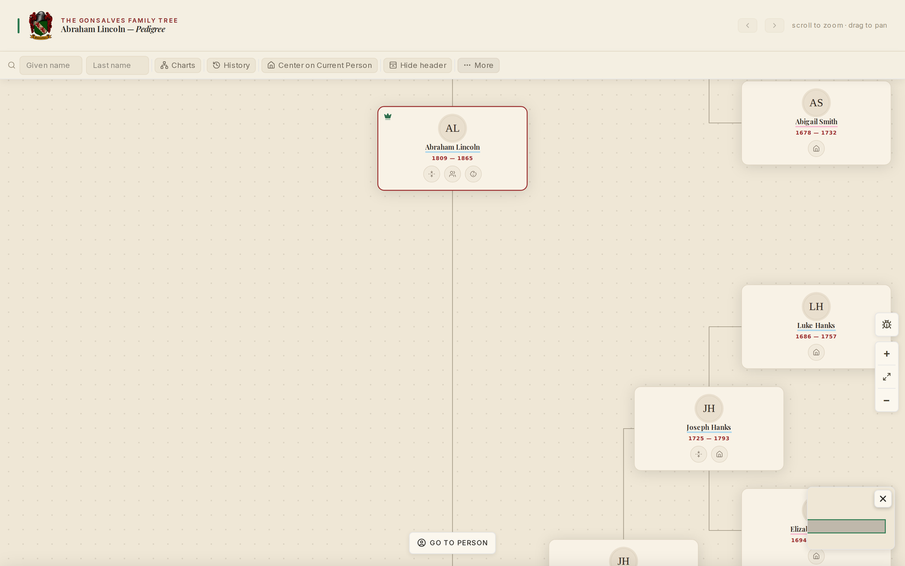
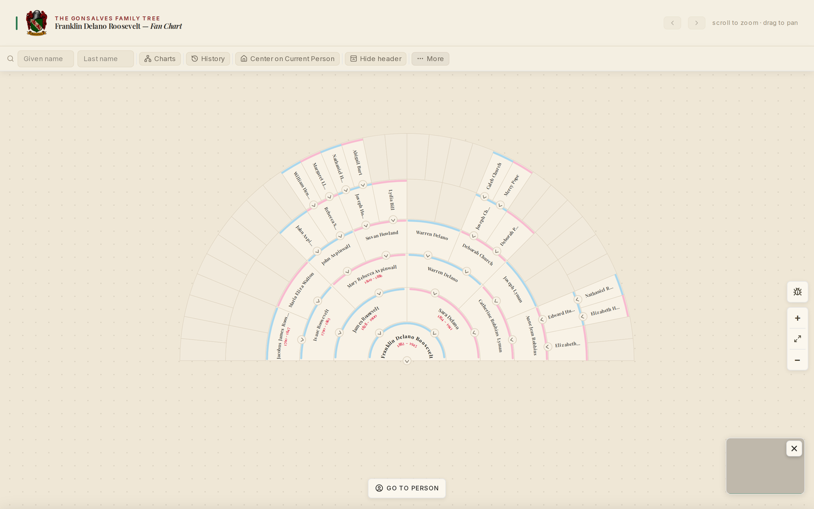
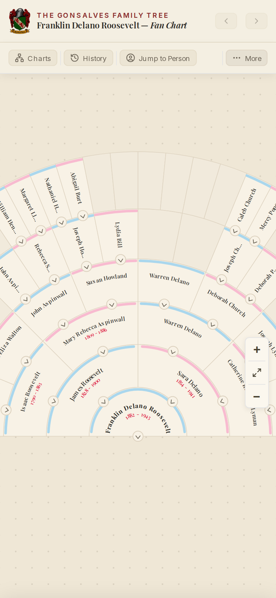

# @ligneous/visualization-engine

Headless chart engine for family trees: it turns people and unions into laid-out chart nodes for descendancy, pedigree, vertical pedigree and fan charts.

**Architecture:** [docs/ARCHITECTURE.md](docs/ARCHITECTURE.md)

The engine does the hard part of a family tree viewer: deciding which people and families appear, and where. It does not draw anything itself. It gives you nodes with `x`/`y` positions, connector geometry, bounds, and (for fan charts) SVG path strings. Your React app renders those as SVG or HTML.

## Screenshots

These come from the Gonsalves family site and its admin app running on a demo database, loaded with the public US-presidents sample tree (`pres2020.ged`) through the real import pipeline. No family data is shown.


*Descendancy chart.*



*Pedigree chart.*



*Fan chart, five generations.*



*Fan chart on a phone.*

## What it does

- **Four chart types**, each a "view strategy":
  - `descendancy`: a person, their unions, and their descendants, top-down.
  - `pedigree`: ancestors left to right (proband in column 0, parents in column 1, and so on).
  - `vertical_pedigree`: ancestors bottom-up, proband at the bottom.
  - `fan_chart`: ancestors as rings of annular sectors around the proband.
- **Layout algorithms**
  - Descendancy uses a two-pass tree layout: subtree widths are computed post-order, then positions are assigned pre-order (`src/strategies/descendancy/layout.ts`).
  - Pedigree centers each person between their parents, father branch above mother branch, with tighter gaps for inner generations (`src/strategies/pedigree/pedigreeLayout.ts`).
  - Vertical pedigree centers each person under their parents' midpoint and reserves width per subtree (`src/strategies/verticalPedigree/verticalPedigreeLayout.ts`).
  - Fan chart geometry is polar: ring thickness per generation, sector paths, text-on-arc paths, label rotation and avatar placement (`src/strategies/fanChart/geometry.ts`, `render.ts`).
- **Real genealogy cases**: multiple spouses, adopted and foster children (GEDCOM `PEDI`), people who are a child in more than one family (`FAMC` choice per person), sibling views, collapsed subtrees, and "+N hidden descendants" badges at the depth limit.
- **Interaction state**: a reducer (`treeReducer`) with back/forward history (up to 21 entries), re-rooting, revealing spouses, showing parents/siblings/children, and panning to a person.
- **React hooks** for the viewer: pan/zoom, search, depth control, fetching chart data, spouse drawer, panel visibility.

## Where it fits in Ligneous

Ligneous is a genealogy platform. A Go library parses GEDCOM files; the data lives in Postgres and is read through Prisma by Next.js apps.

This package powers the interactive family tree on the public site, `the-gonsalves-family` (private). That app imports it through a TypeScript path alias (`@/genealogy-visualization-engine`) and renders the charts in `src/components/TreeViewer/v2`.

### Data it consumes

The engine works on its own small graph shape, defined in `src/types.ts`:

```ts
interface DescendancyPerson {
  id: string;            // GEDCOM xref, e.g. "@I123@"
  firstName: string;
  lastName: string;
  birthYear?: number | null;
  deathYear?: number | null;
  birthPlace?: string | null;
  deathPlace?: string | null;
  photoUrl?: string | null;
  isLiving?: boolean;    // used for living-person privacy on the public site
  gender?: string | null;
  // ...plus uuid and internal layout flags
}

interface UnionRecord {
  id?: string;           // family xref, or `${husb}-${wife}`
  husb: string;          // person id (rendered left)
  wife: string;          // person id (rendered right)
  children: { id: string; pedi: string }[]; // pedi: "birth", "adopted", "foster", ...
}
```

These are GEDCOM concepts (xrefs, `HUSB`/`WIFE`/`CHIL`, `PEDI`), but the engine does not read the Go parser's intermediate representation directly. In the app, the `/api/tree/descendancy`, `/api/tree/pedigree` and `/api/tree/sibling-view` routes query Postgres through Prisma and return `{ rootId, people, unions }` JSON. `useChartViewFetch` maps that JSON into `DescendancyPerson[]` and `UnionRecord[]` (`src/hooks/useChartViewFetch.ts`).

## Install

The package is not published to npm (`"private": true`). It ships TypeScript source; `main` and `exports` point at `src/index.ts`, so your bundler compiles it.

Clone it next to your app and depend on it by path:

```json
{
  "dependencies": {
    "@ligneous/visualization-engine": "file:../genealogy-visualization-engine"
  }
}
```

In Next.js, add it to `transpilePackages`. Peer dependencies: `react` 19 and `@tanstack/react-query` 5 (declared, though the current source does not import React Query).

## Usage

Build and lay out a descendancy chart from your own data:

```ts
import {
  FamilyTreeBuilder,
  DescendancyChartAdapter,
  setCurrentBuilder,
  type DescendancyPerson,
  type UnionRecord,
} from "@ligneous/visualization-engine";

const people: DescendancyPerson[] = [
  { id: "@I1@", firstName: "Ana", lastName: "Silva", birthYear: 1901 },
  { id: "@I2@", firstName: "João", lastName: "Silva", birthYear: 1898 },
  { id: "@I3@", firstName: "Rosa", lastName: "Silva", birthYear: 1925 },
];
const unions: UnionRecord[] = [
  { id: "@F1@", husb: "@I2@", wife: "@I1@", children: [{ id: "@I3@", pedi: "birth" }] },
];

const builder = new FamilyTreeBuilder({ people, unions });
setCurrentBuilder(builder); // the build step still reads this global; see "Known limits"

const adapter = new DescendancyChartAdapter(builder);
const { root } = adapter.buildTreeResult("@I2@", {}, 4);

const descriptor = adapter.getDescriptor();
descriptor.layout(root);                  // sets x / y on every node
const bounds = descriptor.getBounds(root); // { minX, maxX, maxY }
// Walk `root.children` and draw person cards, union diamonds and
// connectors (descriptor.connectors) in SVG.
```

Swap `DescendancyChartAdapter` for `PedigreeChartBuilder`, `VerticalPedigreeChartBuilder` or `FanChartBuilder` to get the other chart types. In a React app, `useChartViewFetch(strategyName, rootId, depth)` does the fetch, mapping and adapter setup for you, but it expects the `/api/tree/*` routes described above.

## API summary

| Area | Main exports |
| --- | --- |
| Data in | `FamilyTreeBuilder`, `DescendancyPerson`, `UnionRecord`, `ViewState` |
| Chart adapters | `DescendancyChartAdapter`, `PedigreeChartBuilder`, `VerticalPedigreeChartBuilder`, `FanChartBuilder`, `CHART_VIEW_STRATEGIES` |
| Layout | `layout`, `getBounds`, `computeFitToViewport`, `defaultConnectors`, size constants (`PERSON_WIDTH`, `PERSON_HEIGHT`, `GAP`, ...) |
| Fan chart geometry | `buildFanGeometry`, `buildAnnularSectorPath`, `buildTextArcPath`, `polarToCartesian`, `computeAvatarPlacement`, `FAN_CHART_DEFAULTS` |
| Node model | `PersonNode`, `UnionNode`, `NormalUnionNode`, `CatchAllNode`, `LinkedParentNode`, `SiblingAdoptiveUnionNode`, `FamilyTreeNodeFactory` |
| State | `treeReducer`, `createInitialState`, `TreeState`, `TreeAction`, `HistoryEntry` |
| React hooks | `useChartViewFetch`, `useTreeBuild`, `usePanZoom`, `usePanToPerson`, `useChartSearch`, `useDepth`, `useSpouseDrawer`, `usePanelVisibility` |
| Helpers | `handlePersonCardAction`, `buildLegendItems`, `countVisibleNodes`, `serializeNode` |

Everything is exported from `src/index.ts`. Subpaths are also importable (`@ligneous/visualization-engine/strategies/...`).

## Build and test

`package.json` has no scripts and the repo has no test suite yet. To type-check (after installing the dev dependencies):

```sh
npx tsc --noEmit
```

Next step: add a test runner and tests for the layout functions.

## Known limits

`REFACTOR_PLAN.md` describes the work in progress. In short: `buildTree` reads people and unions through a module-level "current builder" (`setCurrentBuilder`), and the descendancy strategy still imports a few lookups from `src/testdata`. The plan is to pass an explicit graph snapshot instead. `useChartViewFetch` also hard-codes the `/api/tree/*` routes.

`src/testdata` holds a small fictional family ("Smith") for demos.

## Stack

TypeScript (strict) and React 19 hooks. No D3 or canvas: the engine computes geometry and the app renders SVG.

## Related repos

- [Ligneous](https://github.com/lesfleursdelanuitdev/Ligneous): project overview
- [ligneous-gedcom-lib](https://github.com/lesfleursdelanuitdev/ligneous-gedcom-lib): Go GEDCOM parser, validator and exporter
- `the-gonsalves-family` (private): public site that uses this engine

## License

No license file: all rights reserved.

Part of Ligneous: https://github.com/lesfleursdelanuitdev/Ligneous
