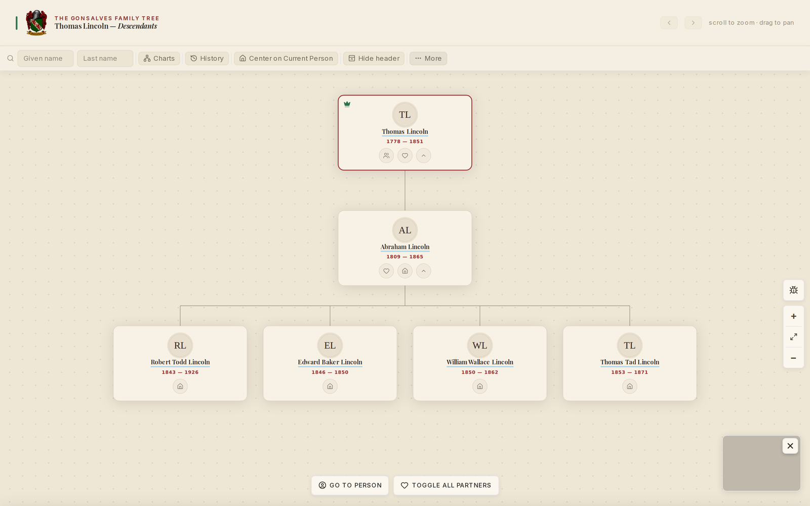
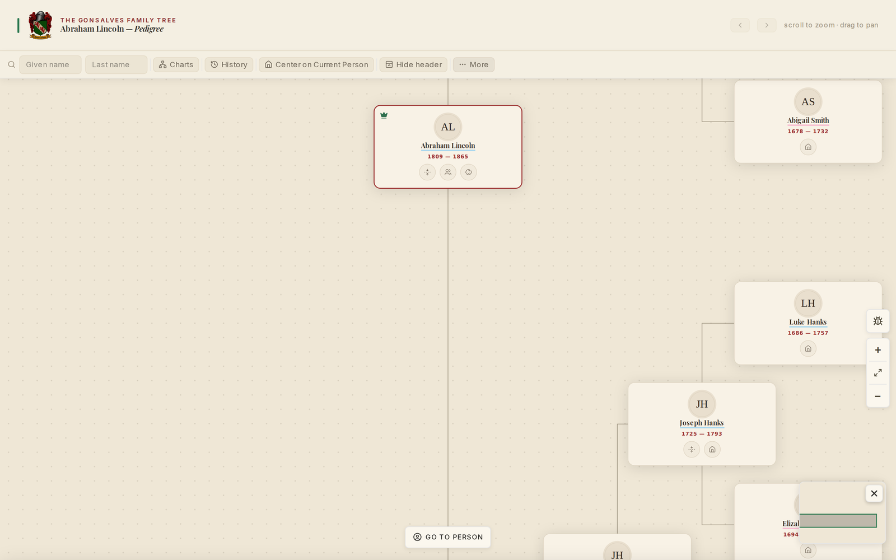
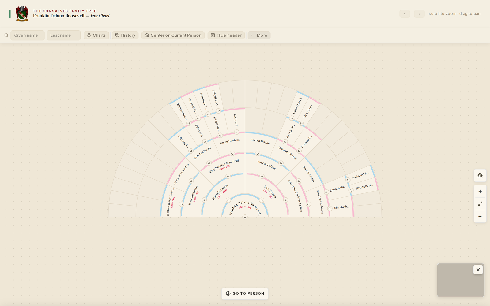
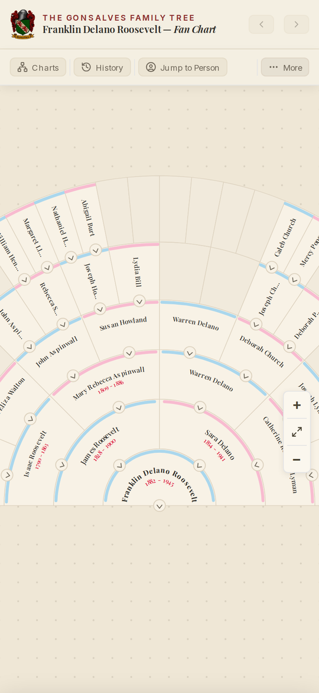

# @ligneous/visualization-engine

Headless chart engine for family trees: it turns people and unions into laid-out chart nodes for descendancy, pedigree, vertical pedigree and fan charts.

**Architecture:** [docs/ARCHITECTURE.md](docs/ARCHITECTURE.md)

The engine does the hard part of a family tree viewer: deciding which people and families appear, and where. It does not draw anything itself. It gives you nodes with `x`/`y` positions, connector geometry, bounds, and (for fan charts) SVG path strings. Your React app renders those as SVG or HTML.

## Screenshots

These come from the Gonsalves family site and its admin app running on a demo database, loaded with the public US-presidents sample tree (`pres2020.ged`) through the real import pipeline. No family data is shown.



*Descendancy chart.*



*Pedigree chart.*



*Fan chart, five generations.*



*Fan chart on a phone.*

## What it does

- **Four chart types**, each a "view strategy":
  - `descendancy`: a person, their unions, and their descendants, top-down.
  - `pedigree`: ancestors left to right (proband in column 0, parents in column 1, and so on).
  - `vertical_pedigree`: ancestors bottom-up, proband at the bottom.
  - `fan_chart`: ancestors as rings of annular sectors around the proband.
- **Layout algorithms**
  - Descendancy uses a two-pass tree layout: subtree widths are computed post-order, then positions are assigned pre-order (`src/strategies/descendancy/layout.ts`).
  - Pedigree centers each person between their parents, father branch above mother branch, with tighter gaps for inner generations (`src/strategies/pedigree/pedigreeLayout.ts`).
  - Vertical pedigree centers each person under their parents' midpoint and reserves width per subtree (`src/strategies/verticalPedigree/verticalPedigreeLayout.ts`).
  - Fan chart geometry is polar: ring thickness per generation, sector paths, text-on-arc paths, label rotation and avatar placement (`src/strategies/fanChart/geometry.ts`, `render.ts`).
- **Real genealogy cases**: multiple spouses, adopted and foster children (GEDCOM `PEDI`), people who are a child in more than one family (`FAMC` choice per person), sibling views, collapsed subtrees, and "+N hidden descendants" badges at the depth limit.
- **Interaction state**: a reducer (`treeReducer`) with back/forward history (up to 21 entries), re-rooting, revealing spouses, showing parents/siblings/children, and panning to a person.
- **React hooks** for the viewer: pan/zoom, search, depth control, fetching chart data, spouse drawer, panel visibility.

## Where it fits in Ligneous

Ligneous is a genealogy platform. A Go library parses GEDCOM files; the data lives in Postgres and is read through Prisma by Next.js apps.

This package powers the interactive family tree on the public site, `the-gonsalves-family` (private). That app imports it through a TypeScript path alias (`@/genealogy-visualization-engine`) and renders the charts in `src/components/TreeViewer/v2`.

### Data it consumes

The engine works on its own small graph shape, defined in `src/types.ts`:

```ts
interface DescendancyPerson {
  id: string;            // GEDCOM xref, e.g. "@I123@"
  firstName: string;
  lastName: string;
  birthYear?: number | null;
  deathYear?: number | null;
  birthPlace?: string | null;
  deathPlace?: string | null;
  photoUrl?: string | null;
  isLiving?: boolean;    // used for living-person privacy on the public site
  gender?: string | null;
  // ...plus uuid and internal layout flags
}

interface UnionRecord {
  id?: string;           // family xref, or `${husb}-${wife}`
  husb: string;          // person id (rendered left)
  wife: string;          // person id (rendered right)
  children: { id: string; pedi: string }[]; // pedi: "birth", "adopted", "foster", ...
}
```

These are GEDCOM concepts (xrefs, `HUSB`/`WIFE`/`CHIL`, `PEDI`), but the engine does not read the Go parser's intermediate representation directly. In the app, the `/api/tree/descendancy`, `/api/tree/pedigree` and `/api/tree/sibling-view` routes query Postgres through Prisma and return `{ rootId, people, unions }` JSON. `useChartViewFetch` maps that JSON into `DescendancyPerson[]` and `UnionRecord[]` (`src/hooks/useChartViewFetch.ts`).

## Install

The package is not published to npm (`"private": true`). `npm run build` writes ESM and `.d.ts` files to `dist/`; `main`, `types` and `exports` point there. The emitted imports have no file extensions, so `dist/` is meant for bundlers (Vite, Next, webpack, vitest), not bare Node ESM.

From a GitHub tag (the `prepare` script builds `dist/` on install):

```json
{
  "dependencies": {
    "@ligneous/visualization-engine": "github:lesfleursdelanuitdev/genealogy-visualization-engine#v0.1.0"
  }
}
```

Peer dependencies: `react` 19 (for the hooks) and `@tanstack/react-query` 5 (declared, though the current source does not import it).

## Usage

Build the graph once per file, then make a chart session for each chart and view state:

```ts
import {
  createGraphSnapshot,
  createChartSession,
  createTreeReducer,
  createInitialState,
  type DescendancyPerson,
  type UnionRecord,
} from "@ligneous/visualization-engine";

const people: DescendancyPerson[] = [
  { id: "@I1@", firstName: "Ana", lastName: "Silva", birthYear: 1901 },
  { id: "@I2@", firstName: "João", lastName: "Silva", birthYear: 1898 },
  { id: "@I3@", firstName: "Rosa", lastName: "Silva", birthYear: 1925 },
];
const unions: UnionRecord[] = [
  { id: "@F1@", husb: "@I2@", wife: "@I1@", children: [{ id: "@I3@", pedi: "birth" }] },
];

const graph = createGraphSnapshot({ people, unions }); // indexes built once

const session = createChartSession({
  graph,
  viewState: { revealedUnions: new Map([["@I2@", ["@I1@"]]]) },
  options: { strategy: "descendancy", maxDepth: 4 },
});
const { root, bounds, baseX, baseY } = session.buildChart("@I2@");
// Draw at translate(baseX + pan.x, baseY + pan.y) scale(scale): walk root.children for
// person cards and union diamonds, and use session.descriptor.connectors for the lines.

// Interaction state: a reducer bound to the same graph (works with React's useReducer).
const reduce = createTreeReducer(graph);
const next = reduce(createInitialState("descendancy", "@I2@"), { type: "REVEAL_ALL_SPOUSES" });
```

`strategy` can also be `"pedigree"`, `"vertical_pedigree"` or `"fan_chart"`. Sessions hold no shared state, so a page chart and a modal chart can build side by side. They are cheap; make a new one when the view state changes and keep reusing the snapshot.

In a React app, `useChartViewFetch(strategyName, rootId, depth)` still fetches the Gonsalves `/api/tree/*` routes and returns `{ chartAdapter, graph, … }`; making fetching pluggable is the next step of the refactor plan (phase 4).

## API summary

| Area | Main exports |
| --- | --- |
| Data in | `createGraphSnapshot`, `GraphSnapshot`, `GraphInput`, `DescendancyPerson`, `UnionRecord`, `ViewState` |
| Charts | `createChartSession`, `ChartSession`, `ChartLayout`, `layoutChart`, `buildTree`, `CHART_VIEW_STRATEGIES` |
| Layout | `layout`, `getBounds`, `computeFitToViewport`, `defaultConnectors`, size constants (`PERSON_WIDTH`, `PERSON_HEIGHT`, `GAP`, ...) |
| Fan chart geometry | `buildFanGeometry`, `buildAnnularSectorPath`, `buildTextArcPath`, `polarToCartesian`, `computeAvatarPlacement`, `FAN_CHART_DEFAULTS` |
| Node model | `PersonNode`, `UnionNode`, `NormalUnionNode`, `CatchAllNode`, `LinkedParentNode`, `SiblingAdoptiveUnionNode` |
| State | `treeReducer(state, action, graph)`, `createTreeReducer(graph)`, `createInitialState`, `TreeState`, `TreeAction`, `HistoryEntry` |
| React hooks | `useChartViewFetch`, `useTreeBuild`, `usePanZoom`, `usePanToPerson`, `useChartSearch`, `useDepth`, `useSpouseDrawer`, `usePanelVisibility` |
| Helpers | `handlePersonCardAction`, `buildLegendItems`, `countVisibleNodes`, `countDescendants` |

Everything is exported from the package root.

## Build and test

```sh
npm install
npm run typecheck   # tsc --noEmit over src/ and test/
npm test            # vitest run
npm run build       # dist/: ESM + .d.ts
npm run check       # all three
```

`test/app/` holds the 74 engine tests copied from the Gonsalves app. `test/bugs/` holds repros for the 2026-10-17 audit's bugs: each is an `it.fails` (through `knownBug()`) until its fix lands. `BUGS_STRICT=1 npx vitest run test/bugs` shows their real failures. `test/fixtures/smith` is a small fictional family for tests and demos.

## Known limits

`REFACTOR_PLAN.md` describes the work in progress. Phases 1–3 are done: the engine reads only the `GraphSnapshot` it is given, and there is no global builder. Still to do: `useChartViewFetch` hard-codes the Gonsalves `/api/tree/*` routes (phase 4), the default root is a Gonsalves person, and the bugs in `test/bugs/` are open. Progress: `docs/v0.1.0-progress.md`.

## Stack

TypeScript (strict) and React 19 hooks. No D3 or canvas: the engine computes geometry and the app renders SVG.

## Related repos

- [Ligneous](https://github.com/lesfleursdelanuitdev/Ligneous): project overview
- [ligneous-gedcom-lib](https://github.com/lesfleursdelanuitdev/ligneous-gedcom-lib): Go GEDCOM parser, validator and exporter
- `the-gonsalves-family` (private): public site that uses this engine

## License

No license file: all rights reserved.

Part of Ligneous: https://github.com/lesfleursdelanuitdev/Ligneous
