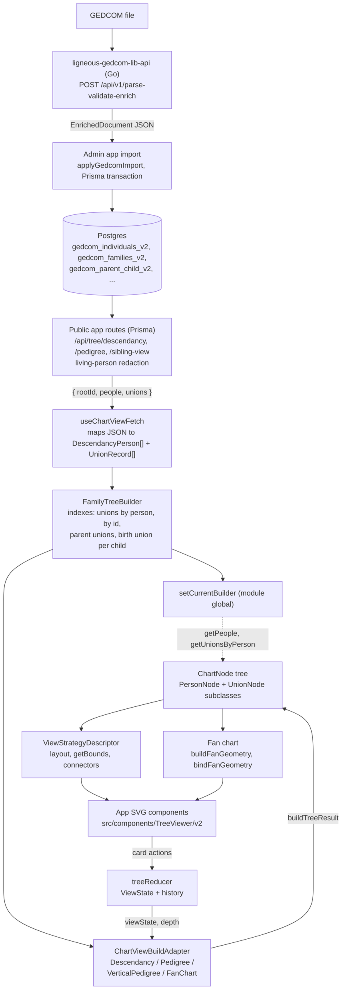

# Architecture: @ligneous/visualization-engine

## Summary

The engine turns a small genealogy graph (people and unions keyed by GEDCOM xref) into laid-out chart nodes for four chart types: descendancy, pedigree, vertical pedigree and fan chart. It computes which people appear, where each card goes, how connectors run and how big the chart is. It never draws. The only runtime import is React, used by the hooks, and the package contains no JSX. The public site renders the result as SVG. Each chart type is a "view strategy" with a common descriptor (build, layout, connectors, bounds, constants). A reducer holds the interactive state (root, revealed spouses, collapsed subtrees, depth, history), and the build step turns that state plus the graph into a fresh node tree on every change.

## Data flow

The admin app (the-gonsalves-family-admin, private) sends each uploaded GEDCOM file to [ligneous-gedcom-lib-api](https://github.com/lesfleursdelanuitdev/ligneous-gedcom-lib-api), which runs the parser, validator and enricher from [ligneous-gedcom-lib](https://github.com/lesfleursdelanuitdev/ligneous-gedcom-lib) and returns an `EnrichedDocument`. The admin app writes it to the `gedcom_*_v2` tables through the shared Prisma client (ligneous-prisma, private). The public site (the-gonsalves-family, private) reads those tables in its `/api/tree/*` routes, hides details of living people from viewers who may not see them, and returns a JSON snapshot keyed by xref. The engine starts at that snapshot. It never sees Prisma rows or the parser's types.

## Modules

| Path | Responsibility |
| --- | --- |
| `src/types.ts` | `DescendancyPerson`, `UnionRecord`, `ViewState`, `SiblingView`, `LinkedUnionEntry` |
| `src/builder/FamilyTreeBuilder.ts` | Takes people and unions, builds lookup maps once, exposes getters and the strategy descriptors |
| `src/builder/currentBuilder.ts` | Module-level "current builder" and global getters (`getPeople`, `getUnionsByPerson`, ...) |
| `src/builder/build.ts` | Generic top-down `buildTree(rootId, strategy, options)` used by descendancy |
| `src/nodes/` | Node model: `PersonNode`, `UnionNode` and its subclasses `NormalUnionNode`, `CatchAllNode`, `LinkedParentNode`, `SiblingAdoptiveUnionNode`; `FamilyTreeNodeFactory` |
| `src/strategies/ViewStrategyDescriptor.ts` | The descriptor interface every chart type implements |
| `src/strategies/descendancy/` | Union-node rules (`DescendancyViewStrategy.ts`), two-pass layout, bounds, connector points, `+N` descendant counts |
| `src/strategies/pedigree/` | Left-to-right ancestor layout and connector points |
| `src/strategies/verticalPedigree/` | Bottom-up ancestor layout |
| `src/strategies/fanChart/` | Polar geometry (`geometry.ts`), SVG path strings and label/avatar placement (`render.ts`), defaults |
| `src/chartView/` | One adapter per chart type behind `ChartViewBuildAdapter`; pedigree has its own ancestor build |
| `src/reducer/` | `treeReducer`: core actions in `handlers.ts`, per-strategy reducers registered in `strategies/registry.ts` |
| `src/hooks/` | React hooks: fetch and adapter setup, pan/zoom, search, depth, spouse drawer, panel visibility |
| `src/helpers/` | Card actions, legend items, viewport fitting, node serialisation |
| `src/testdata/` | A small fictional family for demos, plus a facade that re-exports the global getters |

## Key types

- `DescendancyPerson`: id (xref), names, life years, places, photo URL, `isLiving`, gender, and internal flags such as `_isShadow`, `_onlyRoot` and `_hiddenCount`.
- `UnionRecord`: `husb`, `wife` and `children: { id, pedi }[]`, where `pedi` is the GEDCOM pedigree type (`birth`, `adopted`, `foster`, ...).
- `ViewState`: what the user has opened: `revealedUnions` (person to spouse ids), `linkedUnions`, `siblingView`, `collapsedSubtrees`, `currentDepth`, `familyUnitScope`, and the pedigree `FAMC` choices.
- `ChartNode`: a `PersonNode` or `UnionNode` with `children`, `x`, `y` and `_computedWidth`. A `UnionNode` also has `left` and `right` person cards.
- `ViewStrategyDescriptor`: `createBuildStrategy`, `layout`, `getBounds`, `connectors`, `constants`, and optional `markUnions`, `getHiddenCount` and `getInitialViewState`.

## Layout algorithms

**Descendancy** (`strategies/descendancy/layout.ts`). The tree alternates person, union, children. Pass one walks post-order and sets each node's width: a leaf card is `PERSON_WIDTH`, a union with no children is the union card width, and any other node is the larger of its own card and the sum of its children's widths plus gaps. Pass two walks pre-order from `x = 0`. It centres the children's total span under the parent and gives each child a slot equal to its width. A person whose children are all unions is a "container": its unions stay on the same row as the person, and only their children move down one row. Union nodes also place their left and right cards at fixed offsets so search and bounds see real positions. `markUnions` then flags the first union of each person as primary for connector styling.

The build that feeds this layout is `buildTree` with `DescendancyViewStrategy`. For each person, the strategy returns union nodes only for spouses the user has revealed. Children of unrevealed unions go under a `CatchAllNode`. Linked-parent and sibling-adoptive nodes cover the sibling view and children with more than one family. A person met a second time becomes a shadow card with no children, which stops cycles. At the depth limit, `countDescendants` (memoised, cleared on each fetch) sets a `+N` badge.

**Pedigree** (`strategies/pedigree/pedigreeLayout.ts`). `PedigreeChartBuilder` builds a binary ancestor tree from each person's birth union. The builder prefers the union where the child's `pedi` is `birth`, and the API applies the user's `FAMC` choice. A missing father or mother becomes an "Unknown" placeholder card. Layout: leaves get evenly spaced y values in depth-first order, father branch first. Each person's y is the midpoint of their two parents. x comes from the generation: the root column, then a compact step (a third of the configured gap) for inner generations, then the full gap for the outermost one. Generation 1 also gets the full gap when root siblings are shown. Finally all y values shift so the top card starts at 0.

**Vertical pedigree** (`strategies/verticalPedigree/verticalPedigreeLayout.ts`). It uses the same ancestor tree. A memoised `subtreeWidth` returns the width a person's ancestors need: one card for a leaf, otherwise father width plus gap plus mother width. Positions go top-down from the root at x = 0, with each parent centred in its reserved half. y is `(maxGen - gen) * generationGap`, so the root sits at the bottom. The tree then shifts so the leftmost card starts at half a card width.

**Fan chart** (`strategies/fanChart/`). It reuses `PedigreeChartBuilder` for data. Its descriptor's `layout` and `connectors` do nothing. Instead `buildFanGeometry` splits the angle range (π to 2π by default, a half circle above the centre) into `2^g` equal sectors for generation `g`. The root is a disk. Every later generation is a ring whose thickness grows by a fixed step from a set generation, so outer rings have room for text. Each cell has inner and outer radius, start, end and middle angles. `render.ts` converts a cell into an SVG annular-sector path (two arcs and two lines, or a pie slice for the root). It also builds a text-on-arc path through the middle of the band and an avatar box sized from the band depth and arc length, or `null` if the box would be too small. Label rotation helpers flip text that would read upside down. `bindFanGeometry` attaches a person to each cell by the slot key `generation:index`.

## Interaction state

`treeReducer` handles core actions itself (`ROOT`, `ROOT_KEEP_VIEW`, `SET_VIEW_STRATEGY`, `BACK`, `FORWARD`, `NAVIGATE_TO_INDEX`, `CLEAR_HISTORY`, `RESTORE_HISTORY`). It passes everything else to the reducer registered for the current strategy. The descendancy reducer has 17 actions, such as `REVEAL_SPOUSE`, `SHOW_SIBLINGS`, `PARENTS`, `COLLAPSE_SUBTREE` and `SET_CURRENT_DEPTH`. History keeps the last 21 entries (`MAX_HISTORY`). The app keeps the state and asks the adapter to rebuild the node tree from it.

## Design decisions

| Choice | Cost | Why |
| --- | --- | --- |
| Headless: geometry and node trees only, no SVG or DOM code | The app writes all rendering, including connectors from the descriptor's helper points | Layout can change without touching UI code; the same nodes could drive SVG or HTML |
| One descriptor interface for every chart type | The fan chart needs a no-op `layout` and empty connectors to fit | The viewer can switch chart types through a single adapter |
| Pedigree has its own build instead of `buildTree` | Two build paths to maintain | Ancestors form a binary tree with unknown-parent placeholders, unlike the union-driven descendancy tree |
| Fan and vertical pedigree reuse the pedigree build and API | They share its limits (one birth family per person) | One fetch shape serves three ancestor views |
| Graph keyed by GEDCOM xref | Xrefs are only unique within one tree file | The API routes and URLs already use xrefs |
| Revisited people become shadow cards | A person can appear twice | Stops infinite recursion on pedigree collapse or bad data, and still shows the link |
| Indexes built once in `FamilyTreeBuilder` | Rebuilt on every fetch | Replaced repeated full scans of the union list (see `src/DESCENDANCY_PERFORMANCE_REFACTOR.md`) |
| Ships TypeScript source (`exports` to `src/`) | The app must transpile it | No build or publish step |

## Testing

There are no tests. The repo has no test runner, no test files and no `scripts` in `package.json` (118 source files, all `.ts`). `src/testdata/` holds about 400 lines of fixture data and helpers that a future test suite could use. Type-checking with `npx tsc --noEmit` needs the dev dependencies installed.

## Known limitations

- **Global current builder.** `buildTree`, the descendancy strategy, several descendancy reducer handlers and two helpers read the graph through module-level getters. `setCurrentBuilder` must be called before building, and only one tree can be active per JavaScript context. The descriptors and `BuildContext` already carry the data, so the globals are partly redundant.
- **Runtime code imports from `testdata`.** Those imports go through a facade that re-exports the builder getters, so they read real data, but the module name is misleading. `REFACTOR_PLAN.md` plans an explicit `GraphSnapshot` to replace both.
- **Fixed API routes.** `useChartViewFetch` hard-codes `/api/tree/descendancy`, `/api/tree/pedigree` and `/api/tree/sibling-view`.
- **Fan chart bounds** are computed from radius alone (`minX: 0`, `maxX: radius`), not from the cells.
- **Peer dependency** on `@tanstack/react-query` is declared but the source does not import it.
- No tests, as above.
